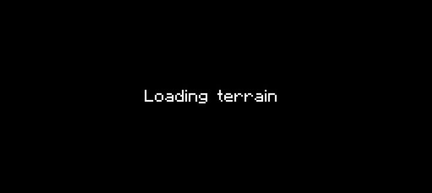

# Hi, I'm David López Velasco 👋

**Software Developer in Training | AI Engineering Student | Full-Stack Enthusiast**

I'm a software development student based in Málaga, Spain, currently studying **Artificial Intelligence Engineering at UNED (Universidad Nacional de Educación a Distancia)**.

I'm also studying **Multiplatform Application Development (DAM)**, building a strong foundation in programming, software engineering, and application development.

I'm passionate about creating digital solutions, exploring new technologies, and understanding how artificial intelligence can transform the way we develop software and solve real-world problems.

Beyond programming, I'm interested in video games, game development, and interactive digital experiences.

I believe the best way to learn is by building real projects, experimenting with new ideas, and continuously improving my skills.

**Learn. Build. Improve. Repeat.**

## Tech Stack

**Programming Languages & Web Development**

**Frameworks & Technologies**

**Development Tools**

## Featured Projects

### [Daovez Portfolio](https://github.com/daovez/daovez-portfolio)

My personal developer portfolio, where I showcase my projects, technical skills, learning journey, and experience with modern web technologies.

**Technologies:** React, JavaScript, HTML, CSS.

### Daovez Studio

A digital studio project focused on developing professional websites, custom software solutions, and AI-powered automation for businesses.

**Focus:** Web Development, Software Engineering, Artificial Intelligence, Business Automation.

### Personal Projects & Experiments

A growing collection of applications, programming exercises, technical experiments, and game development projects.

These projects help me strengthen my programming knowledge and explore different areas of software development.

## Currently Learning

- **Artificial Intelligence Engineering** — UNED.
- **Multiplatform Application Development** — DAM.
- **Full-Stack Development** — JavaScript, React, Node.js.
- **Software Engineering** — Java, object-oriented programming, and software architecture.
- **Artificial Intelligence** — Python, algorithms, and machine learning fundamentals.
- **Databases** — SQL and data management.
- **Development Workflows** — Git, GitHub, and deployment.
- **Game Development** — Interactive applications and game programming.

## My Goals

My long-term goal is to become a highly skilled software engineer with strong expertise in artificial intelligence and modern application development.

I'm especially interested in:

- Building scalable web applications.
- Developing intelligent software solutions.
- Applying AI to real-world business problems.
- Creating automation tools that improve productivity.
- Exploring the intersection of software engineering, AI, and game development.
- Continuously learning and sharing knowledge.

## GitHub Statistics

## Connect With Me

- **Portfolio:** [daovez.dev](https://daovez.dev)
- **LinkedIn:** [David López Velasco](https://www.linkedin.com/in/david-lopez-velasco)
- **GitHub:** [@daovez](https://github.com/daovez)

---

*Building, learning, and improving — one project at a time.*
